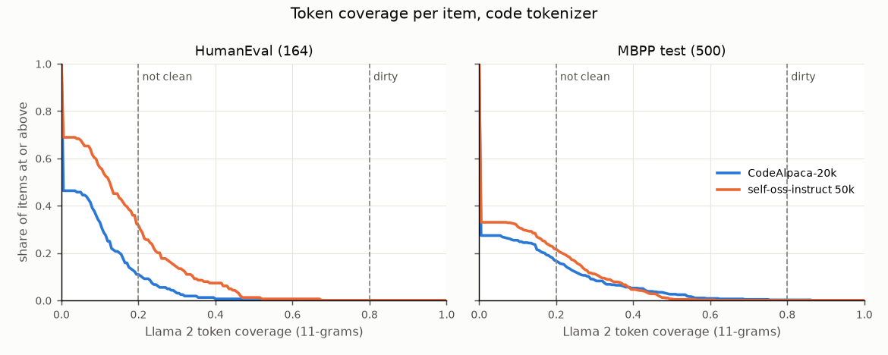

# contamscan

[](https://github.com/vipul21435/contamscan/actions/workflows/ci.yml)

contamscan checks whether the items of an evaluation set appear in a training corpus under
four published rules side by side (GPT-3 13-gram overlap, PaLM 70 % of 8-grams, Llama 2
token coverage, and exact or normalised containment), and lists each matching document
with character offsets. Given per-item scores, it compares clean and contaminated items.

HumanEval against the 50,661 records of bigcode/self-oss-instruct-sc2-exec-filter-50k
(code tokenizer, 4 processes): 80 of 164 items share a 13-token span, none reaches the
PaLM or Llama 2 dirty thresholds, and the 4 items with a 50-token match are shared tables
and idioms (number words, Roman numerals, a prime loop), not copied problems
([Results](#results-on-public-code-data)).

## Why this is hard

A benchmark item rarely appears in a corpus byte for byte: it is re-indented, re-cased,
split across a prompt and an answer, or quoted in part inside a longer document. Fixed
n-gram rules disagree on the same data (one shared 13-gram makes an item "dirty" under the
GPT-3 rule, while PaLM asks for 70 % of all 8-grams), common code idioms such as
`for i in range(n):` match everywhere, and corpora are far larger than memory. A useful
audit therefore has to stream the corpus once, apply several published rules side by side,
show the matched text so a person can judge it, and check whether contaminated items are
actually scored higher.

## Install

```bash
pip install git+https://github.com/vipul21435/contamscan
# Parquet input needs pyarrow:
pip install "contamscan[parquet] @ git+https://github.com/vipul21435/contamscan"
```

Python 3.10 or newer. The only required dependency is numpy. The scripts in `examples/`
are not part of the installed package; clone the repository to run them.

## Quickstart

```text
$ git clone https://github.com/vipul21435/contamscan && cd contamscan && pip install .
$ python examples/synthetic_comparison.py runs/synthetic   # writes eval.jsonl, corpus.jsonl, runs a scan
$ contamscan scan runs/synthetic/eval.jsonl runs/synthetic/corpus.jsonl --fields question \
    --score-field pass --json report.json --markdown report.md --fail-above 0.05
FAIL: palm fraction 0.200 > 0.05
200 items, 2060 documents, 1.2 s
  gpt3           55 contaminated (27.5%)
  palm           40 contaminated (20.0%)
  llama2         40 contaminated (20.0%)
  substring      40 contaminated (20.0%)
$ echo $?
1
```

The synthetic set has 200 items of random words, 60 of them planted whole or in part in
2,060 random documents. For your own data, replace the two paths and `--fields` (and
`--corpus-fields` for the corpus, default `text`). `report.md` and `report.json` list every
item's overlap under each method, its label and the matched documents with offsets.

## How it works

**Tokens.** `--tokenizer word` (default) case-folds, drops punctuation and splits on
whitespace, which follows the GPT-3 rule of comparing words "ignoring all punctuation,
whitespace, and casing". `--tokenizer code` keeps case and emits identifiers, numbers and
each operator character as tokens, because `Foo`/`foo` differ in code and punctuation
carries structure. In both, combining marks stay in their word, each token's text is
NFKC-normalised (an NFD or fullwidth copy gives the same tokens as the original), and each
Han, hiragana and katakana character is a token of its own, since Chinese and Japanese put
no spaces between words; character n-grams are the usual unit for such text. Every token
keeps its character span in the raw text. The text of an item is its
`--fields` joined by newlines, and a corpus document's text is its `--corpus-fields` joined
the same way. A field that holds a list or an object (a chat `messages` list, answer
choices) is replaced by its string values, one per line, so a turn copied verbatim is
matched as text rather than as JSON with escapes and quotes. Exact containment is checked on the raw text and on a
normalised form (NFKC, case-folded, punctuation removed, whitespace collapsed).

**Index.** Each token is hashed with BLAKE2b to 64 bits; an n-gram hash is the polynomial
`sum(t_i * B^(n-1-i)) mod 2^64`, updated in O(1) per position. For each n used by a method
the evaluation set's n-gram hashes go into a dict `hash -> [(item, position)]`. The corpus
is streamed once (`--workers K` spreads documents over K processes); each document's
n-gram hashes are looked up and the hit positions are accumulated per item. Memory grows
with the evaluation set, not the corpus: the longest run is tracked while walking the
document in order, keeping per item only the run length at each item position matched at
the previous document position. Time per document is proportional to the number of
(item position, document position) hits of the chaining n-gram, so a document made of one
repeated n-gram that also repeats in an item is slow but does not grow memory
(`tests/test_scan_memory.py` bounds the traced peak at 12 MB for a 12,300-character
separator block against an item holding a 60-character separator; it measured 3.1 MB,
against 50.7 MB when every hit pair was stored). With 64-bit hashes the chance of a false
match between two given n-grams is about 2^-64. Property tests check the index, the
document-frequency filter and the skipgram budget against direct scans of random text
drawn from small vocabularies, whole-item containment against a direct substring check,
and the tokenizers on text in NFC, NFD, NFKC and NFKD form. Test coverage is 99 % of
statements (`uv run pytest --cov=contamscan`, 106 tests).

**Methods.** For an item with k tokens and g_n = k - n + 1 n-grams:

| method | quantity | label | source of the default |
|---|---|---|---|
| `gpt3` | matched 13-grams / g_13 | `dirty` if any 13-gram is shared; items shorter than 13 tokens are matched whole | Brown et al. 2020, Appendix C ([arXiv 2005.14165](https://arxiv.org/abs/2005.14165)) |
| `palm` | matched 8-grams / g_8 | `contaminated` if >= 0.70; `too-short` (never counted as contaminated) if the item has fewer than 8 tokens | Chowdhery et al. 2022, Section 8 ([arXiv 2204.02311](https://arxiv.org/abs/2204.02311)) |
| `llama2` | tokens inside any matched 11-gram / k | `clean` < 0.20, `dirty` >= 0.80, `mixed` between | Touvron et al. 2023, Appendix A.6 ([arXiv 2307.09288](https://arxiv.org/abs/2307.09288)) |
| `substring` | longest run of tokens shared with one document | `exact` if the whole item text is contained in a document (raw or normalised), `long-match` if the run is >= 50 tokens | this tool's choice |

Flags and where their defaults come from:

- `--gpt3-n 13`: GPT-3 uses the 5th-percentile example length in words, with "a minimum
  value of 8" and "a maximum value of 13". `--gpt3-n auto` applies that rule to the
  evaluation set (lower order statistic, clamped to [8, 13]).
- `--palm-n 8 --palm-threshold 0.70`: PaLM counts an example as contaminated if "at least
  70% of the 8-grams in question, prompt, or target were seen at least once". By default
  the fields are joined; `--palm-per-field` takes the fraction over the n-grams inside each
  field and flags the item when any field reaches the threshold.
- `--llama-n 11 --llama-clean 0.20 --llama-dirty 0.80`: Llama 2 counts a token as
  contaminated if it lies in a shared n-gram "longer than 10 tokens"; clean is below 20 %,
  dirty is at or above 80 %. The paper repeats the analysis with minimum match lengths
  10 to 50; pass a larger `--llama-n` to do the same.
- `--llama-skip-budget 0`: the paper lets matched spans "differ in at most four positions"
  (no mismatches in the first 10 tokens, none trailing). With a budget B > 0, exact runs on
  the same alignment between item and document are joined while the tokens between them
  total at most B; the first run must be at least n - 1 tokens long and the joined span at
  least n tokens. The default is exact matching because this is an approximation (see
  Limitations); pass 4 for the paper's budget.
- `--max-doc-freq K` (off by default): ignore item n-grams found in more than K documents
  for `gpt3`, `palm` and `llama2` (a `--llama-skip-budget` span is dropped when one of the
  n-grams it is built from is that common). GPT-3 "ignored 13-grams that matched more than 10
  training documents" in its training-set filter because they were mostly common phrases
  and boilerplate; for code, `K = 10` drops stock idioms.
- `--substring-min-tokens 50`: not from a paper; a run of 50 tokens is long enough that
  common code idioms rarely reach it (see the results below).

The longest run is found by chaining matches of the smallest n along a diagonal (item
position p and document position j, then p+1 and j+1, ...); a run of r matching n-grams is a
shared span of r + n - 1 tokens.

Whole-item containment is checked for every item against every document, independently of
the n-gram index and of `--tokenizer`, so an item re-cased or re-indented in a document is
found even when the code tokenizer shares no n-gram with it. A second small index holds, for
each item, a hash of up to 8 consecutive words of its normalised text (leaving out the first
and last word, which a document may cut mid-word); each document's normalised words are
looked up in it and only the items found there are compared in full, raw and normalised.

A document is reported for an item when it shares a run of at least the smallest n (8 by
default) or contains the whole item; other documents, even ones sharing shorter runs, are
not listed. For each item the report keeps the `--max-matches` documents, containment first
and then the longest spans, with character offsets in both the item and the document. A
containment match counts all the item's tokens as shared and covers the whole item; for a
normalised-only hit, the document offsets run from the start of the first to the end of
the last whitespace-delimited chunk holding the matched words.

**Exit status and input checks.** With `--fail-above F` the command exits with status 1
when the contaminated fraction under `--fail-method` (default `palm`) is above `F`, so it
can gate a CI job. It exits with status 2 and a one-line `contamscan: error: ...` message
when the input cannot give a meaningful answer: an empty evaluation set, a `--fields` name
absent from every evaluation record (a misspelt field would otherwise give every item empty
text and a 0 % rate), a score that is not a finite number, a corpus in which no document
has any text, a malformed corpus record (truncated JSON, bytes that are not UTF-8, a line
that is not a JSON object; the message names the file and line), a truncated or corrupt
`.jsonl.gz` file, a corpus file of an unsupported type, or a report directory that does not exist (checked before the scan). A
field missing from only some records, a `--corpus-fields` name found in no record,
documents with empty text and files skipped in corpus directories are reported as warnings
on stderr.

**Inputs.** The evaluation set is JSONL or Parquet with an id, the text fields to check and
optionally a per-item score. A corpus argument is a file or a directory: `.jsonl`,
`.jsonl.gz` and `.parquet` files are read one record at a time (Parquet reads only the text
and id columns), `.txt`, `.md`, `.py` and `.rst` files are one document each, and suffixes
are compared case-insensitively. In a directory, files of other types are skipped and
counted in a warning; a file of another type named directly is an error, unless
`--text-files` is given, which reads it whole as one document. A record without
`--corpus-id-field` gets the id `<path relative to the corpus argument>:<record number>`
(`train/part-0.jsonl:17`), a text file its relative path (`repo_a/README.md`).

**Python API.**

```python
from contamscan import Params, iter_corpus, load_eval, summarise
from contamscan.scan import scan

items = load_eval("eval.jsonl", ["prompt", "solution"])
results = scan(items, iter_corpus(["corpus/"], ["text"]), Params(), tokenizer="code")
print(summarise(results)["methods"]["gpt3"])
for m in results[0].matches:
    print(m.doc_id, m.doc_start, m.doc_end, m.tokens)
```

**Score comparison.** When `--score-field` is set the report has three parts.

1. For every method, `mean(contaminated) - mean(clean)` with a percentile bootstrap
   interval (`--n-boot`, default 10,000; the two groups resampled independently; `--seed`).
   For Llama 2 both of the paper's splits are given: dirty versus not dirty, and not clean
   versus clean. A test checks the interval's coverage by simulation.
2. The Llama 2 statistic for each of the four subsets (clean, not clean, not dirty,
   dirty): `Z_n = (mean(subset) - mu_n) / sigma_n`, where `mu_n` is the mean over all N items
   and `sigma_n^2 = s^2 / n` is the variance of the mean of n items drawn independently
   from the set (`s^2` the population variance). The paper calls a dataset affected when
   all four subsets have |Z_n| > 2. Its prose does not say how the sampling distribution
   is formed, but its Table 51 fixes it: for a subset and its complement the ratio of
   their |Z| equals `sqrt(n_large / n_small)` (HellaSwag, 70B: 9.56 / 5.73 = 1.668 against
   `sqrt(7391 / 2651)` = 1.670), which holds for `s / sqrt(n)` and not for a
   finite-population form, under which the two Z would be equal and opposite.
   `--llama-z-fpc` applies the correction `(N - n) / (N - 1)` instead. Tests check both
   forms against simulated sampling and the ratio identity.
3. GPT-3's comparison: the score on the clean-only items against the score on all items,
   as a relative change `(clean - full) / full`. GPT-3 reads a clean score "more than 1% or
   2% worse than the overall score" as a sign of overfitting to seen examples.

## Results on public code data

HumanEval (164 items, `prompt` + `canonical_solution`) and the MBPP test split (500 items,
`text` + `code`) scanned against two public code instruction sets: CodeAlpaca-20k
(20,022 records, `instruction` + `input` + `output`) and
bigcode/self-oss-instruct-sc2-exec-filter-50k (50,661 records, `instruction` +
`response`, read directly from Parquet). Each pair is scanned with both tokenisers in three
settings: default flags (`default`), the GPT-3 and PaLM variants
`--gpt3-n auto --palm-per-field --max-doc-freq 10` (`paper`), and the approximate Llama 2
skipgram budget `--llama-skip-budget 4` (`skip4`). Commands:

```bash
bash examples/fetch_code_data.sh data/raw                 # about 98 MB
python examples/prepare_code_data.py data/raw data/jsonl  # Parquet/JSON -> JSONL
bash examples/run_code_audit.sh data runs 4               # 24 scans, 4 worker processes
python examples/summarise_runs.py runs
```

Items flagged with default flags and the code tokenizer (N is the GPT-3 n-gram size;
"any overlap" counts items sharing at least one n-gram of any size used with some
document, or contained whole in one). All 24 rows, with the word tokenizer and the `paper`
and `skip4` settings, are in [docs/results.md](docs/results.md):

| eval | corpus | tokenizer | flags | N | gpt3 dirty | palm | llama2 dirty | llama2 not clean | substring | any overlap | scan s | wall s |
|---|---|---|---|---:|---:|---:|---:|---:|---:|---:|---:|---:|
| humaneval | code_alpaca_20k | code | default | 13 | 53 (32.3 %) | 0 | 0 | 18 (11.0 %) | 0 | 139 | 1.5 | 1.6 |
| humaneval | self_oss_instruct_50k | code | default | 13 | 80 (48.8 %) | 0 | 0 | 52 (31.7 %) | 4 (2.4 %) | 160 | 11.2 | 11.3 |
| mbpp_test | code_alpaca_20k | code | default | 13 | 88 (17.6 %) | 1 (0.2 %) | 1 (0.2 %) | 83 (16.6 %) | 1 (0.2 %) | 289 | 1.8 | 1.9 |
| mbpp_test | self_oss_instruct_50k | code | default | 13 | 105 (21.0 %) | 0 | 0 | 108 (21.6 %) | 0 | 330 | 11.3 | 11.4 |

The counts were produced again after the fixes in the changelog and did not change; the
times are from the earlier run (see docs/results.md for the machine load).

`--workers` on the HumanEval against self-oss-instruct scan with the code tokenizer, scan
time as printed by the tool, on the same 8-core laptop with a load average between 5 and
12 from other jobs, so the times depend on the machine and its load: 26.4 s with 1
process, 13.7 s with 4, 12.6 s with 8. The command, run from the data directory with
W = 1, 4 and 8:

```bash
contamscan scan jsonl/humaneval.jsonl raw/self_oss_instruct_50k.parquet \
    --fields prompt,solution --corpus-fields instruction,response --tokenizer code --workers W
```



`docs/coverage-code.png` (`python examples/plot_coverage.py runs code docs/coverage-code.png`,
needs matplotlib) shows, for the default code-tokenizer runs, the share of items whose
token coverage is at or above each level. No HumanEval item and one MBPP item reach the
dirty line.

Examples (item, document id in the corpus, character offsets in that document):

- `mbpp/374` against CodeAlpaca-20k, `alpaca-18534` characters 153-450: a string
  permutation routine, `next_list = [] for i in range(0,len(prev_list)): for j in
  range(0,len(str)): ...`. Code tokenizer: 86 shared tokens, 81.0 % of 8-grams, 86.2 %
  token coverage, so it is `contaminated` under PaLM and the only item `dirty` under Llama 2
  in any run.
- `HumanEval/19` against self-oss-instruct, document `141434` characters 1391-1503: the
  number-word dictionary `'zero': 0, 'one': 1, ... 'nine': 9` (59 code tokens). Likewise
  `HumanEval/105` (`1: "One", 2: "Two", ...`, document `336305`), `HumanEval/156` (the
  Roman-numeral symbol list, document `252334`) and `HumanEval/96` (a trial-division prime
  loop, document `158426`). These are the four `long-match` items; each is a shared
  table or idiom, not a copied problem, and each item's token coverage stays below 47 %.
- `HumanEval/55` against self-oss-instruct (word tokenizer, `paper` flags), document
  `79440` characters 144-237: the
  recursive Fibonacci body `if n == 0: return 0 if n == 1: return 1 return fib(n - 1) +
  fib(n - 2)`. With `--palm-per-field` the solution field is 100 % matched and the item is
  flagged; joined with the prompt it is at 35.7 %. With the code tokenizer the longest match
  is characters 136-238 of the same document (33 tokens; an equally long match sits at
  905-1007, and ties go to the earliest position) and the solution field reaches only 56.5 %,
  so the item is not flagged.
- `mbpp/226` against CodeAlpaca-20k (word tokenizer), `alpaca-439` characters 0-94: the
  problem statement "Write a python function to remove the characters which have odd index
  values of a given string".
- `mbpp/90` against self-oss-instruct, document `5760` characters 42-99: "Write a python
  function to find the length of the longest", flagged only by `--palm-per-field` because
  a one-sentence MBPP statement has few 8-grams and a stock opening fills most of them.

Reading: under the strict GPT-3 rule a few percent of items share a 13-word span with
either corpus, and with the code tokenizer (where 13 tokens cover much less code) a fifth to
a half do; most of those spans are idioms such as prime tests, sorting loops and
number-word tables. No HumanEval item and at most one MBPP item reaches the PaLM or Llama 2
thresholds with joined fields. Per-field PaLM adds a handful of items, mostly short MBPP
statements whose wording is a template ("Write a python function to find the ..."), so
its flags need reading before they are believed. `--max-doc-freq 10` removes 0 to 5 GPT-3
flags per run and lowers the not-clean count by up to 13 items (HumanEval, code tokenizer,
self-oss-instruct), which is the expected effect of dropping n-grams that occur in many
documents. The approximate skipgram budget moves almost nothing here: it adds one or two
items to the not-clean count in three runs and none to dirty, because the matches found
are short shared idioms rather than long copies with a few edits.

### Planted contamination

The runs above cannot say what the methods miss, because the true contamination of the
corpora is unknown. `examples/planted_recall.py` plants 100 of the 164 HumanEval items into
CodeAlpaca-20k, 20 in each of five forms, each appended to the output of a different
random record (seed 0), and leaves 64 unplanted:

```bash
python examples/planted_recall.py data runs/planted   # 4 scans; 11.5 s wall time, load average above 30
```

Items flagged, out of the number in the "items" column (word and code tokenizer, each
with and without `--llama-skip-budget 4`; the `skip4` rows differ only where shown):

| tokenizer | planted as | items | gpt3 dirty | palm | llama2 dirty | llama2 not clean | substring |
|---|---|---:|---:|---:|---:|---:|---:|
| word | full (prompt + solution, verbatim) | 20 | 20 | 20 | 20 | 20 | 20 |
| word | prompt only | 20 | 20 | 6 | 3 | 20 | 11 |
| word | solution only | 20 | 14 | 0 | 0 | 13 | 2 |
| word | recased (upper case, tabs) | 20 | 20 | 20 | 20 | 20 | 20 |
| word | edited (every 10th code token replaced) | 20 | 2 | 0 | 0 | 1 (skip4: 2) | 0 |
| word | not planted | 64 | 5 | 0 | 0 | 4 | 0 |
| code | full | 20 | 20 | 20 | 20 | 20 | 20 |
| code | prompt only | 20 | 20 | 10 | 4 | 20 | 18 |
| code | solution only | 20 | 17 | 0 | 0 | 17 | 6 |
| code | recased | 20 | 13 | 0 | 0 | 8 | 20 |
| code | edited | 20 | 8 | 0 | 0 | 5 (skip4: 7) | 0 |
| code | not planted | 64 | 27 | 0 | 0 | 12 | 1 |

Reading: every method finds a verbatim copy of the whole item. When only half of the item
leaks (prompt or solution), PaLM and Llama 2 dirty, which ask for most of the item, miss
half or more of them, while the any-13-gram rule and the Llama 2 not-clean subset still catch
them; the price is the false flags on unplanted items (5 of 64 with words, 27 of 64 with
code tokens). The word tokenizer is blind to case and layout, the code tokenizer is not,
and there the normalised containment check (`substring`) finds all 20 recased items,
while the n-gram methods flag at most 13 of them. Dense edits defeat every exact n-gram method; the approximate skipgram budget
recovers one or two more items only in the not-clean count.

### Score comparison on synthetic data

The score comparison needs per-item scores, and none were used for the code data above. A
seeded synthetic run shows it
(`python examples/synthetic_comparison.py runs/synthetic`, 1.7 s wall time): 200 items of
random words, 60 of them planted whole or in part in 2,060 random documents, simulated
pass rates 0.45 for unplanted and 0.75 for fully planted items. **These scores are
simulated, not model output.**

```text
200 items, 2060 documents, 1.2 s
  gpt3           55 contaminated (27.5%)
  palm           40 contaminated (20.0%)
  llama2         40 contaminated (20.0%)
  substring      40 contaminated (20.0%)
```

From `runs/synthetic/report.md` (the `llama2` row is dirty versus not dirty):

| split | n clean | n contaminated | mean clean | mean contaminated | difference | 95% interval |
|---|---:|---:|---:|---:|---:|---|
| gpt3 | 145 | 55 | 0.469 | 0.782 | +0.313 | [+0.173, +0.445] |
| palm | 160 | 40 | 0.475 | 0.875 | +0.400 | [+0.263, +0.519] |
| llama2 | 160 | 40 | 0.475 | 0.875 | +0.400 | [+0.263, +0.519] |
| substring | 160 | 40 | 0.475 | 0.875 | +0.400 | [+0.263, +0.519] |
| llama2_not_clean_vs_clean | 141 | 59 | 0.461 | 0.780 | +0.319 | [+0.186, +0.448] |

| Llama 2 subset | n | mean | mu_n | sigma_n | Z |
|---|---:|---:|---:|---:|---:|
| clean | 141 | 0.461 | 0.555 | 0.042 | -2.25 |
| not clean | 59 | 0.780 | 0.555 | 0.065 | +3.47 |
| not dirty | 160 | 0.475 | 0.555 | 0.039 | -2.04 |
| dirty | 40 | 0.875 | 0.555 | 0.079 | +4.07 |

GPT-3 clean-only score 0.469 on 145 items against 0.555 on all 200: relative change
-15.5 %.

The 40 fully planted items are found by every method. Of the 20 items planted as a third
of their words, 15 are flagged by the any-13-gram rule (55 = 40 + 15) and 19 fall in the
Llama 2 band between clean and dirty; none reaches the PaLM or Llama 2 dirty thresholds.
All four Llama 2 subsets have |Z| > 2, the paper's condition for calling a set affected.

### Scores and data sources

No per-item model results were used here, so these runs have no score comparison; it is
shown only on the synthetic example above. EvalPlus publishes greedy model samples for
HumanEval on its GitHub releases page, but not per-problem pass/fail verdicts, and
producing verdicts would mean executing model-generated code, which was not done. The
nuprl/MultiPL-E-completions dataset on Hugging Face holds completions with execution
results, but its dataset card states no licence, so it was not used.

Data sources and licences, each checked on its dataset card:

| dataset | licence | page |
|---|---|---|
| HumanEval | MIT | https://huggingface.co/datasets/openai/openai_humaneval |
| MBPP (full, test split) | CC BY 4.0 | https://huggingface.co/datasets/google-research-datasets/mbpp |
| CodeAlpaca-20k | CC BY 4.0 | https://huggingface.co/datasets/sahil2801/CodeAlpaca-20k |
| self-oss-instruct-sc2-exec-filter-50k | ODC-By | https://huggingface.co/datasets/bigcode/self-oss-instruct-sc2-exec-filter-50k |

None of this data is stored in the repository. iamtarun/python_code_instructions_18k_alpaca
was considered and not used because its card states no licence.

## Limitations

- The Llama 2 skipgram budget is approximated, not reproduced: `--llama-skip-budget`
  (default 0, exact matching) joins exact runs of at least the smallest n (8 by default)
  on the same alignment and counts every token between them as a mismatch, so two edits
  closer together than that are charged the whole gap. Llama 2 also counts model tokens,
  while this tool counts word or code tokens.
- `--max-doc-freq` does not apply to the longest-span (`substring`) method or to the
  whole-item match of items shorter than N.
- The Llama 2 sampling distribution is computed analytically (`sigma_n = s / sqrt(n)`),
  not by drawing subsets as the paper may have done; the two agree up to Monte Carlo
  noise.
- A JSON array corpus file is not supported; convert it to JSONL (see
  `examples/prepare_code_data.py`). Of compressed formats only gzip JSONL (`.jsonl.gz`) is
  read; `.zst`, `.bz2` and compressed text files are not, and a file named directly with
  such a suffix is an error. A malformed record stops the scan; there is no option to skip
  bad records. With joined fields an n-gram may span two fields;
  `--palm-per-field` changes only the PaLM fraction.
- Whole-item containment is found only through the word anchor: an item whose normalised
  text has one or two words must occur as whole words, and an item with no letters or
  digits (punctuation only) is never checked for containment.
- Other scripts written without spaces (Thai, Lao, Khmer, Burmese) are still split only at
  spaces and punctuation by `--tokenizer word`, so a long clause is one token; Korean
  Hangul is split into words, not syllables.
- No fuzzy or embedding-based matching: paraphrased, renamed or translated items are not
  found.
- The real-data results above have no model scores, so the effect on scores is shown only
  on synthetic data.
- Scan time per document grows with the number of hits of the chaining n-gram, which is
  quadratic for an n-gram repeated many times in both an item and a document (separator
  lines, padding); memory stays bounded.
- The index is an in-memory dict, fine for benchmarks of thousands of items; an evaluation
  set of many millions of n-grams would need a more compact structure.

## Related tools

- [datasieve](https://github.com/vipul21435/datasieve): drops training records that match a
  reference split during deduplication; contamscan instead audits an evaluation set against
  a corpus, explains each match and measures the effect on scores.
- [evalstats](https://github.com/vipul21435/evalstats): error bars and paired comparisons for
  model evaluations.
- [sftlint](https://github.com/vipul21435/sftlint): lint chat, SFT and tool-calling datasets.
- [taskledger](https://github.com/vipul21435/taskledger): schema validation and lint rules for
  benchmark-task bundles.
- [graderguard](https://github.com/vipul21435/graderguard): audit graders for reward hacking
  and flakiness.

## Licence

MIT, see [LICENSE](LICENSE).

Built by Vipul Raj Jha · https://vipul21435.github.io
